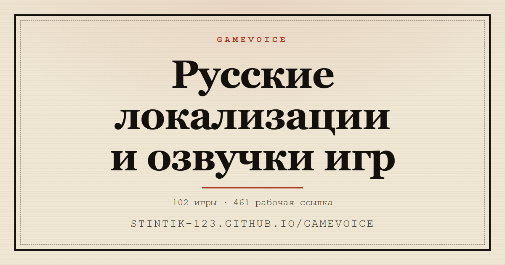

<div align="center">



# GameVoice

**Каталог русских локализаций и озвучек игр: 102 игры, 461 проверенная ссылка**

[](https://stintik-123.github.io/GameVoice/)

</div>

---

GameVoice — это место, где можно за минуту найти, скачать и установить русскую озвучку или русификатор для своей игры. Никаких форумов из 40 страниц и мёртвых ссылок: каждая ссылка в каталоге автоматически перепроверяется, мёртвые стираются.

**[Играть по-русски → stintik-123.github.io/GameVoice](https://stintik-123.github.io/GameVoice/)**

## Почему это удобно

- **102 игры** — 13 карточек собраны вручную (описания, авторы переводов, трейлеры), ещё 89 подтягиваются из открытого API GamesVoice
- **Никаких мёртвых ссылок** — ссылки автоматически перепроверяются, нерабочие исчезают из каталога
- **Честный поиск** — пишите «киберпанк» и найдёте Cyberpunk 2077: поиск понимает транслит и опечатки
- **Фильтры и вид** — тип локализации (текст / озвучка / субтитры), жанр, статус перевода; сетка, список или лента
- **Избранное** — отслеживайте нужные игры, всё хранится локально в браузере
- **Живые трейлеры** — фон главной страницы играет Steam-ролики найденной игры
- **PWA** — сайт можно установить как приложение и пользоваться с телефона
- **Честные карточки** — у каждой игры автор перевода, версия, дата обновления и статус: готово, в процессе или заброшено

## Как пользоваться

1. Откройте [каталог](https://stintik-123.github.io/GameVoice/)
2. Найдите игру через поиск (клавиша `/`) или фильтры
3. В карточке выберите нужный вариант локализации и ссылку на скачивание
4. Готово — инструкция по установке есть в самой карточке

Не нашли свою игру? [Откройте issue](https://github.com/Stintik-123/GameVoice/issues) — добавим.

## Для разработчиков

Витрина без сборки: HTML/CSS + ES-модули. Данные живут в `js/data.js` и собираются из двух источников — ручных карточек (`js/data-curated.js`) и открытого API GamesVoice (`data/gamesvoice-products.json`).

```bash
npm install            # dev-зависимости (playwright)
npm run serve          # http://localhost:8099
npm run fetch:api      # обновить данные из API GamesVoice
npm run check:links    # перепроверить все ссылки
npm run build:catalog  # пересобрать js/data.js
npm run check:site     # 15 e2e-проверок
```

Мёртвые ссылки перепроверяются еженедельно GitHub Actions (`link-check.yml`, lychee): 404 и таймауты вырезаются из карточек, а 401/403/429 считаются блокировкой бота, а не поломкой ссылки.

## Лицензия

[MIT](LICENSE)
